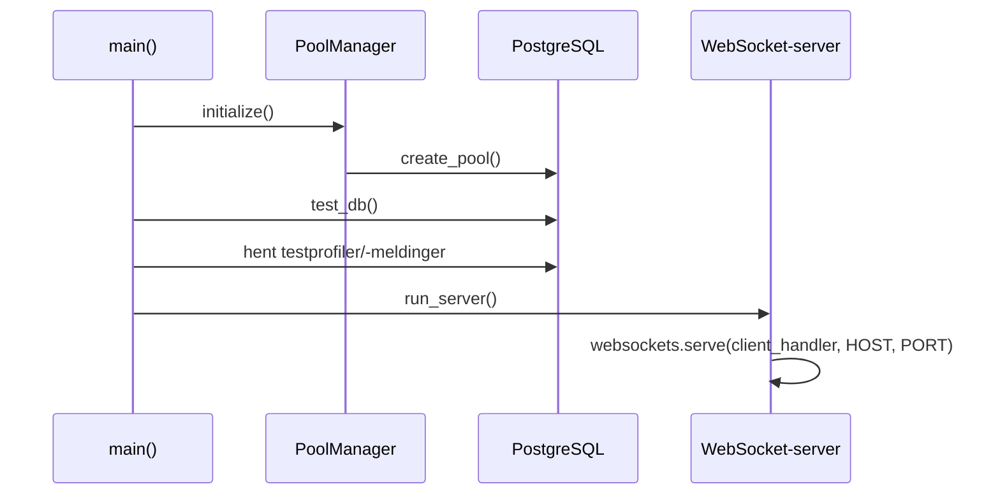

# Arkitektur og moduler

**Kilde:** `server3/` på `unified-main`.

## Oppstartssekvens

`server_manager.py` definerer `main()` og kjører den med `asyncio.run(main())` på modulnivå. `main()` initialiserer `server_pool`, tester databasetilkoblingen med `test_db()`, gjør diagnostiske databaseoppslag og starter `run_server()`. `run_server()` bruker `websockets.serve(client_handler, HOST, PORT, ping_interval=None)` og venter på at serveren lukkes.

## Ansvarsfordeling

| Modul | Faktisk ansvar |
|---|---|
| `server_manager.py` | Tilkobling, utdeling av token, totrinns innlogging, klientløkke, ruting og opprydding |
| `datapacket_manager.py` | Pydantic `Packet`/`ResponsePacket`, `Task`-dataklasse og pakkeparser |
| `security_manager.py` | Passordverifisering mot databasen og kontroll av rettighetsnivå |
| `server_utils.py` | Hash/verifisering med Argon2, JWT-generering/dekoding, blacklist, profiloppslag |
| `request_manager.py` | `ping`, aktive brukere, DM-/gruppe-rom og administrative forespørsler |
| `message_manager.py` | Direktemeldinger, gruppemeldinger, historikk og DB-logging |
| `group_manager.py` | `GroupChat` med tilknyttede brukere; helper for DM-rom |
| `database_manager.py` | In-memory registre, rommodell og parametriserte SQL-spørringer |
| `db_pool_manager.py` | Navngitte `asyncpg` connection pools |
| `loads.py` | Importerer biblioteker og laster `config.json`/`users.json` |
| `threadmanager.py` | Påbegynt tråd-/jobbmodell; store deler er `pass` |

## Tre forskjellige typer tilstand

1. **Persistent:** PostgreSQL-tabellene `users` og `messages` (og whitelist for `groups`, `rooms`).
2. **Flyktig:** Globale Python-dictionaryer for aktive WebSockets, økter, grupper og rom i `database_manager.py`.
3. **Konfigurasjon:** `server3/config.json` med host, port, handlingskart og tillatelsesnivåer. `users.json` lastes ved oppstart, men er ikke den samme datakilden som PostgreSQL-tabellen `users`.

## Oppmerksomhetspunkter

- Serveren er *asynkron* med `asyncio`, ikke en fullt implementert thread-pool-server.
- `server3/networkmanager.py`, `cow_logger.py` og `error_handler.py` er ikke et komplett produksjonssystem; de to siste er tomme.
- Flere eldre funksjoner er fortsatt tilgjengelige i kildekoden. Det må skilles mellom at en funksjon **finnes**, at den er **registrert i config**, og at den **kan kalles korrekt**.
- Alt som ligger i minnecache forsvinner ved prosessomstart; PostgreSQL-data gjør ikke det.

[Kildekode: server_manager.py](https://github.com/TonzN/Server-project/blob/unified-main/server3/server_manager.py) · [database_manager.py](https://github.com/TonzN/Server-project/blob/unified-main/server3/database_manager.py)
