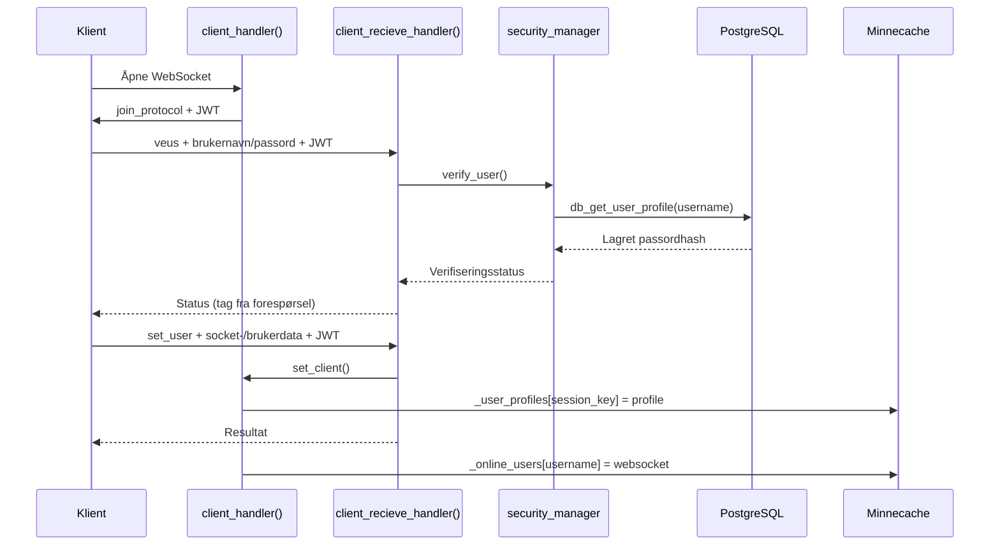
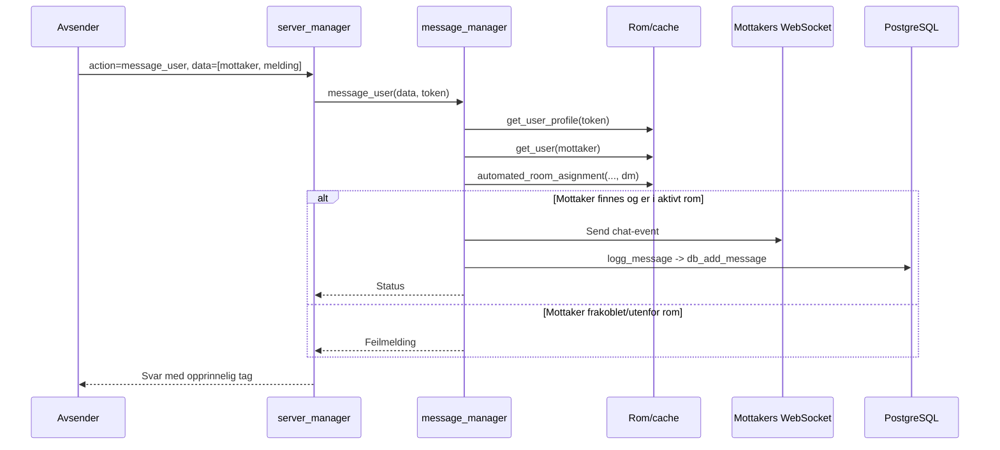

# Dataflyt

## 1. Ny tilkobling og innlogging

`client_handler()` mottar WebSocket-tilkoblingen, genererer et JWT, sender det med `join_protocol`, og kaller `login()`. Login forventer `veus` (verifisering) eller `create_user` og deretter `set_user`.



**Implementasjonsforbehold:** `set_client()` leser `userdata["socket"]`; vanlige JSON-pakker kan ikke inneholde et ekte Python-WebSocket-objekt. Klientens angitte socket blir heller ikke erstattet med den autoritative forbindelsen før lagring. Dette er et designavvik som må rettes før flyten kan regnes som robust.

## 2. Innkommende klientkommando

```mermaid
flowchart TD
    A[websocket.recv] --> B[validate_packet: JSON til Packet]
    B --> C{Gyldig pakke?}
    C -- Nei --> E[Feilrespons]
    C -- Ja --> D[Les action/data/tag/token]
    D --> F{action i config.function_keys?}
    F -- Nei --> E
    F -- Ja --> G[Velg synkron eller async handler]
    G --> H[Utfør funksjon via globals()]
    H --> I[create_reponse med data og tag]
    I --> J[websocket.send]
```

Ruting er drevet av `config.json`, der f.eks. `"ping": "ping"` peker på funksjonen med samme navn importert i `server_manager.py`. Handlingskartet er altså et API-register, ikke en dynamisk plugin-loader.

## 3. Direktemelding



**Viktig avvik:** Koden logger vanligvis **etter** vellykket WebSocket-sending. Kommentarene antyder at meldinger også skal lagres for frakoblede mottakere, men den nåværende implementasjonen returnerer tidlig og lagrer ikke denne typen melding. Det finnes heller ingen dokumentert leveringskvittering eller transaksjon som binder levering og DB-lagring sammen.

## 4. Hente DM-historikk

`pull_user_chat_history_to_user([username], token)` henter øktens navn, sjekker at motpartens profil finnes i DB, kaller `db_get_messages_from_user_to(sender, username)` og returnerer serialiserte poster. SQL-spørringen henter begge retninger og sorterer etter `timestamp`.

```sql
SELECT * FROM messages
WHERE (sender = $1 AND receiver = $2)
   OR (sender = $2 AND receiver = $1)
ORDER BY timestamp;
```

`$1`/`$2` sendes som parametere til `asyncpg`, ikke interpolert klientinput. Meldingshistorikkens returverdi blir i gjeldende dispatcher konvertert med `str(...)`, ikke standard JSON-serialisering; dette bør standardiseres.

## 5. Ping, timeout og disconnect

`ping(msg, token)` oppdaterer `profile["heartbeat"] = time.time()` og returnerer `pong`. `client_handler()` sammenligner gjeldende tid med `heartbeat` og forsøker disconnect etter ca. 30 sekunder uten oppdatering. Disconnect fjerner brukeren fra `_online_users`, rydder opp i rom og økter, svartelister tokenet og lukker WebSocket. `websockets` sin automatiske ping er deaktivert (`ping_interval=None`), så applikasjonens egen ping er sentral.

[Kilde: server_manager](https://github.com/TonzN/Server-project/blob/unified-main/server3/server_manager.py) · [message_manager](https://github.com/TonzN/Server-project/blob/unified-main/server3/message_manager.py)
