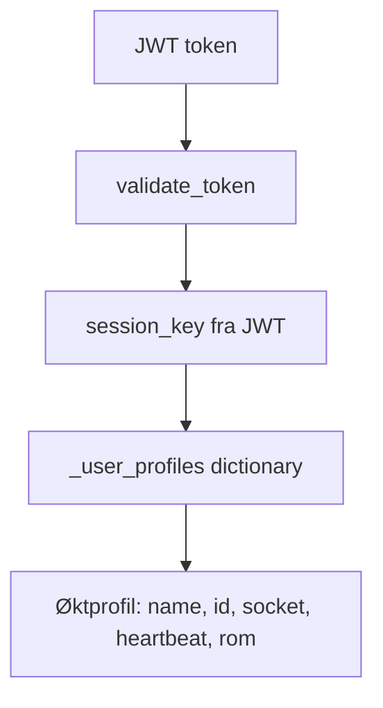

# Brukermodell og variabler

Serveren opererer med **to forskjellige brukerprofiler**, i tillegg til et token og et oppslag fra brukernavn til socket. Dette skillet er sentralt.

## 1. Persistent profil i PostgreSQL (`users`)

Feltene er eksplisitt satt i `create_user()` og brukt av `db_add_user_profile()`:

| Felt | Type/eksempel | Formål |
|---|---|---|
| `username` | tekst | Offentlig/logisk brukernavn og nøkkel for oppslag |
| `password` | Argon2-hash (tekst) | Verifisering; aldri klartekst i databasen |
| `id` | streng med innledende nuller | Generert brukeridentifikator, normalt fem siffer |
| `permission_level` | `basic` eller `admin` | Tilgangsmodell |
| `security_mode` | `normal` | Sikkerhetsnivå i DB-feltnavn |

`create_user()` skriver først `profile["securitymode"]`, uten understrek, men konverterer verdier posisjonelt for SQL-kolonnen `security_mode`. Bruk alltid DB-kolonnenavnet når skjemaet beskrives. Feltlisten er basert på innsettingen i kode, ikke en verifisert SQL-migrasjonsfil.

## 2. Flyktig øktprofil (`_user_profiles[session_key]`)

Opprettes av `set_client()` ved vellykket autentisering:

```python
profile = {}
profile["name"] = userfile["username"]
profile["id"] = userfile["id"]
profile["connection_error_count"] = 0
profile["heartbeat"] = time.time()
profile["socket"] = sock
profile["subscribed_room"] = None
profile["rooms_joined"] = []
add_profile(session_key, profile)
```

| Nøkkel | Type | Bruk |
|---|---|---|
| `name` | `str` | Brukernavn for gjeldende økt |
| `id` | `str` | Bruker-ID fra DB |
| `connection_error_count` | `int` | Initialiseres til 0; lite brukt i gjennomgått flyt |
| `heartbeat` | Unix-tid `float` | Sist oppdaterte heartbeat via `ping()` |
| `socket` | WebSocket-objekt | Tilkoblingen til klienten |
| `subscribed_room` | `str` / `None` | Aktiv DM-rom-ID eller gruppenavn |
| `rooms_joined` | `list` | Rom for opprydding; oppføringer på formen `[room_key, room_id]` |

**Viktig:** Øktprofilen er intern servertilstand. Den skal ikke serialiseres og sendes til andre klienter: `socket` er en levende referanse og profilen inneholder aktivitets-/rutinformasjon.

## 3. JWT og sesjonsnøkkel

`generate_token()` lager en JWT med `session_key` (UUID-streng) og `exp` (utløp etter én time). JWT signeres med HS256. `get_user_profile(token)` kaller først `validate_token(token)`, leser `session_key` fra tokenet og slår opp `_user_profiles[session_key]`. Et gyldig token er dermed ikke i seg selv nok til å få en brukerprofil dersom økten ikke finnes.



## 4. Andre in-memory registre

| Variabel | Innhold |
|---|---|
| `_online_users` | `username -> WebSocket` |
| `_user_profiles` | `session_key -> sesjonsprofil` |
| `_groups` | `group_name -> GroupChat`, initialisert med `global` |
| `_user_room2` | Mapping for DM-rom mellom brukerpar |
| `_rooms` | `room_id -> romobjekt/-dictionary` |
| `_room_invites` | Invitasjoner per bruker |
| `blacklisted_tokens` | Tilbakekalte JWT-er (kun i prosessminnet) |

`GroupChat` har `name: str` og `users: dict`, med `find_user`, `add_user` og `remove_user`. Romstrukturen for DM håndteres separat i `database_manager.py`. Vær oppmerksom på at aktive rom kan gå tapt ved restart, selv når meldingshistorikken ligger i PostgreSQL.

## 5. Meldingsmodell

`db_add_message()` skriver `(sender, receiver, message)` til PostgreSQL-tabellen `messages`. Oppslagene benytter i tillegg `timestamp` og `message_id`, som derfor forventes i eksisterende databaseskjema. Databasens presise kolonnedefinisjoner og constraints er **ikke verifisert** fra en migrasjonsfil.

[Kilde: create_user/set_client](https://github.com/TonzN/Server-project/blob/unified-main/server3/server_manager.py) · [server_utils.py](https://github.com/TonzN/Server-project/blob/unified-main/server3/server_utils.py)
