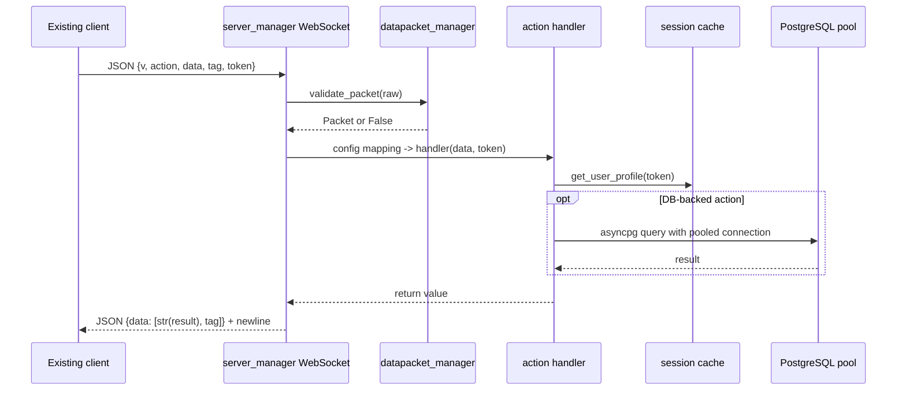

# Server 4 data flow (unchanged from Server 3)

## Connection/login sequence
`client_handler` issues a generated JWT in a response with tag
`join_protocol`. The client invokes `veus` (or `create_user`) followed by
`set_user`. `set_client` validates credentials, creates an in-memory session
profile keyed by JWT `session_key`, and later the main handler stores the
WebSocket in `_online_users`. Ping updates the session `heartbeat`.
On disconnect, the server cleans up rooms, profile, token and connection.

## DM message path
`message_user(["bob","hello"], token)` obtains the sender from the
validated session. It checks the recipient's online socket and whether they
are active in the sender's subscribed DM room. It sends the existing `chat`
push directly to that socket, **then** calls `logg_message` to insert
`sender`, `receiver`, `message` into PostgreSQL. Failure before the
send skips logging. The requester gets a handler result wrapped using its
original tag.

## Read / write ownership
- `db_pool_manager`: connection pool.
- `database_manager`: PostgreSQL queries and in-memory registries.
- `security_manager`: credential and permission checks.
- `request_manager`: room membership and heartbeat actions.
- `message_manager`: message delivery and chat history.
- `server_manager`: transport, handshake and action dispatch.

The dispatcher keeps its existing sync/async action mapping and string
conversion; do **not** assume every declared async function is correctly
registered. See compatibility notes.
